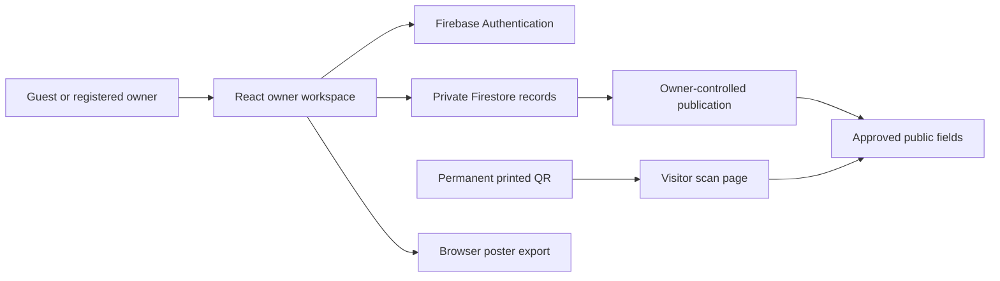
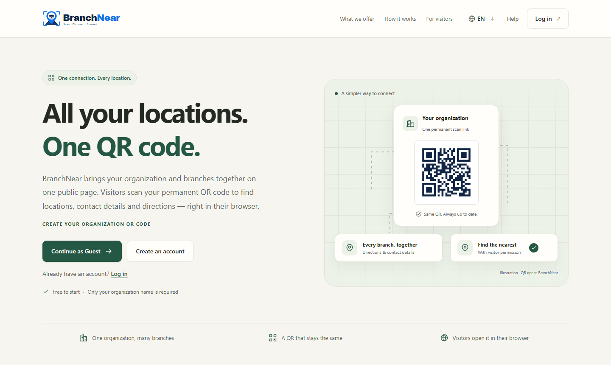
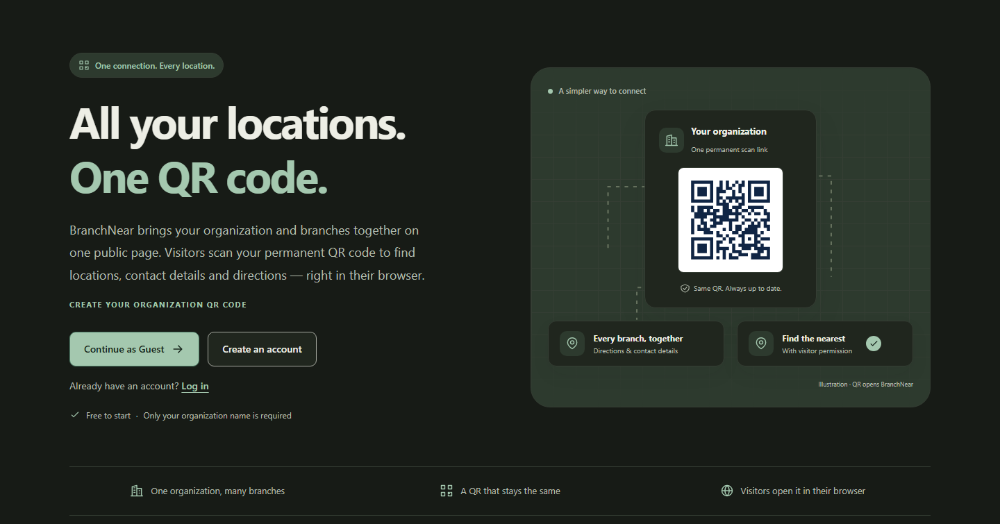
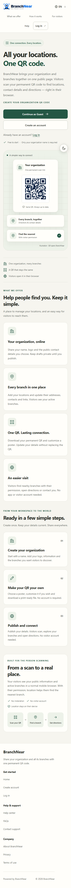
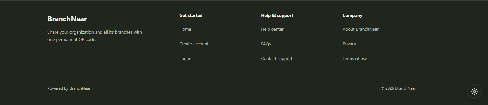

# BranchNear

**A branch-sharing web application that keeps printed QR links useful as an organization grows.**

  

## The problem: printed information becomes stale

An organization with several branches needs one reliable way to share addresses, contact details and directions. Printing a new QR code whenever a branch changes creates avoidable maintenance work.

BranchNear gives organizations a persistent public destination. Owners manage their information and posters; visitors open the published branch list without creating an account. Updating a branch preserves the organization's QR identity.

## From first branch to a shareable poster

| Capability | Implemented behavior |
| --- | --- |
| Guest onboarding | Start an organization without registration and link ownership to an account later. |
| Branch management | Edit branches, manage active/archive states and retain stable identities. |
| Poster studio | Customize layouts, colors, text and images; save designs; export PDF, PNG, JPG and SVG. |
| Public discovery | Read published branch information and optionally calculate nearest branches from available coordinates. |
| Localization | Twelve interface and poster locales, theme controls and responsive navigation. |
| Administration | Permission-scoped administration, moderation, support and notifications. |

Nearest-branch results use straight-line distance. Directions and booking links hand off to external providers. Previously loaded public pages have documented cached offline behavior; initial access still requires connectivity.

## Architecture: private ownership, deliberate publication

Static React and TypeScript bundles are built with esbuild and delivered through Firebase Hosting. Firebase Authentication and Firestore rules enforce ownership. The visitor bundle uses a separate public data boundary. Poster generation uses browser rendering, QR generation and PDF tooling; the current application does not need a Next.js server.

## Engineering decisions

Preserving public identities while supporting guest-to-account ownership is a central challenge. The implementation separates public handles from private record ownership. Publication projects approved fields rather than exposing owner records.

Multilingual exports introduce another challenge: fonts and layout must work outside the browser after download. The project includes script-aware fonts and locale handling for its poster pipeline.

### Interface evidence

Dark theme and mobile layout

The existing showcase assets and [previous case study](docs/previous-showcase.md) are preserved alongside this expanded draft.

This existing application screenshot shows the grouped product, support and company navigation. It has been visually reviewed for this draft. Further demonstrations can use fictional organizations and addresses in an isolated emulator environment.

## Security and release status

The inspected implementation includes explicit publication consent, owner-scoped rules and administrative permissions. Public pages expose approved fields; credentials and operational receipts are excluded from this showcase. Advertising controls exist but ad serving remains disabled pending external approvals.

Core workflows are implemented. Existing documentation records a hosted release and remaining device, performance and localization checks. No deployment or application acceptance tests were run during this preservation review. Some older architecture prose differs from the newer cached-page behavior, so this case study follows the current README without claiming every release check is complete.

## Next milestones

- Complete physical-device and export acceptance across supported languages.
- Reconcile older architecture documentation with the latest public-page behavior.
- Continue performance and accessibility review.
- Validate any advertising activation separately against real approval evidence.

## Portfolio and acknowledgements

Presented by [chiranjit-chakma](https://github.com/chiranjit-chakma). Built using React, Firebase, esbuild and QR/PDF libraries. This repository contains a product case study and presentation assets; application implementation remains in the private development repository.
