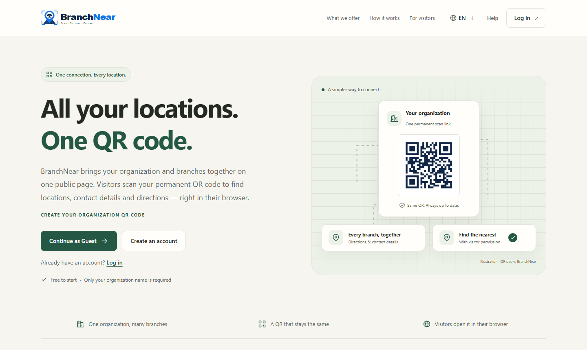
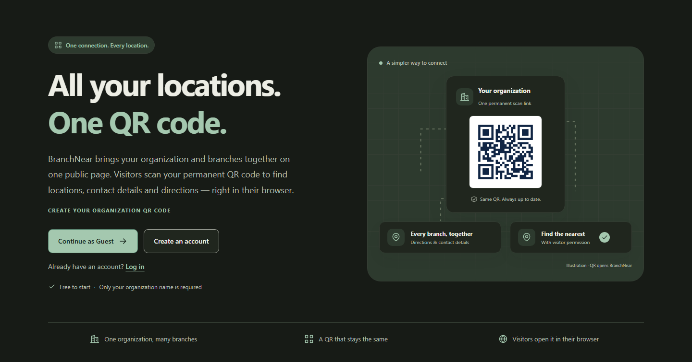
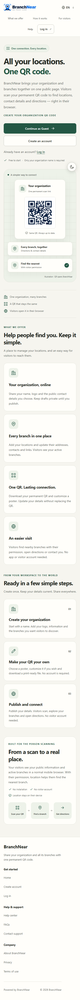

  <picture>
    <source media="(prefers-color-scheme: dark)" srcset="../assets/logo-dark.png">
    
  </picture>

<h1 align="center">All Your Locations. One QR Code.</h1>

An organization and branch-sharing platform that connects a printed QR code to an updatable digital presence.

<a href="https://branchnear.web.app"><strong>Explore the live website →</strong></a>

## The problem

Organizations with multiple locations often share separate map links, contact details and printed materials for each branch. When details change, those materials can become outdated and visitors have to search for the right location.

## The solution

BranchNear brings an organization's identity and branches together behind one permanent QR link. Owners maintain their information and poster designs, while visitors open a browser to discover active locations and available contact options.

The permanent link keeps printed materials useful as branch information changes. Publication controls let owners choose when their information becomes visible.

## Product experience

| Capability             | What users can do                                                                                      |
| ---------------------- | ------------------------------------------------------------------------------------------------------ |
| Organization profiles  | Add branding, descriptions, contacts and optional links.                                               |
| Multiple branches      | Maintain locations, addresses and branch-specific contact options.                                     |
| Permanent QR identity  | Update organization and branch information while preserving the shared QR destination.                 |
| Poster customization   | Edit text, colours, layout, fonts and images; save designs for reuse.                                  |
| Downloadable posters   | Export PDF, PNG, JPG and SVG, with common print sizes.                                                 |
| Visitor discovery      | View active branches, search locations and optionally find the nearest branch.                         |
| Ownership and control  | Start as a guest, claim an organization through an account, and manage editing, archival and deletion. |
| Multilingual interface | Use twelve interface languages, including right-to-left layouts.                                       |
| Responsive design      | Use the interface on small and large screens, in light or dark mode.                                   |
| Offline recovery       | Reopen previously loaded public organization pages from cached information.                            |

## A simple workflow

1. Create an organization and add its branches.
2. Customize a poster and publish the information you want to share.
3. Download and display the permanent QR poster.
4. Update locations and details as needed; visitors continue using the same QR link.

## Design decisions

- **Stable printed links:** Organization identity stays separate from changing branch information.
- **Low-friction discovery:** Visitors can browse published information without creating an account.
- **Owner control:** Private drafts, explicit publication and confirmed deletion help keep changes intentional.
- **Flexible presentation:** Poster editing supports customization while protecting the QR's destination and readability.
- **Inclusive interfaces:** Responsive layouts, readable colours, light/dark themes and multilingual navigation support different contexts of use.

## Screenshots

The images below show the live public homepage without customer records or signed-in accounts.

### Desktop · light mode

  
<strong>Homepage content · dark mode</strong>

  
<strong>Mobile layout</strong>

   
  

## Technical overview

React and TypeScript power the interface. Firebase provides authentication, data storage and hosting. QR generation, map interactions and poster rendering support the product's sharing and discovery workflows.

## Project scope

The project covers product flows, responsive visual design, account and guest journeys, organization/branch management, poster customization, multilingual interfaces and deployment. Browser regression checks cover key workflows and export behavior.

This repository is a product showcase containing a case study and presentation images. Application source code and operational documentation are maintained privately.

**[Try BranchNear](https://branchnear.web.app)**
